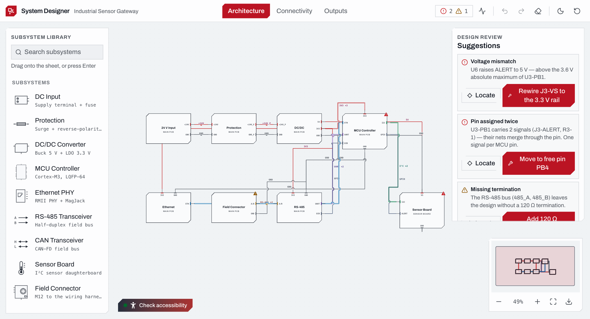

# JointJS+: Electronic System Designer <a href="https://www.jointjs.com/jointjs-plus"></a>

Let your users design electronic systems visually, right inside your web app. This demo is an EDA-style editor for a 24 V industrial sensor gateway: functional blocks joined by typed interface bundles on an architecture view, a pin-level connectivity schematic with obstacle-avoiding wiring, electrical rule checks that propose one-click fixes, click-to-trace nets across both views, animated operating values, and always-current engineering outputs (BOM, connector pinouts, wire list, netlist).

## What this demo shows

- **Two synchronized canvases over one design** — an architecture view (subsystem blocks and interface bundles such as power, I²C, UART, RS-485 and Ethernet) and a connectivity view (parts with real pin names and numbers, nets, junction dots, board outlines); both are derived from a single design document, so they can never disagree
- **Pin-accurate wiring** — wires connect to native JointJS ports; on the connectivity sheet they are routed around part symbols by `@joint/router-avoid` (libavoid compiled to WebAssembly, running in a Web Worker)
- **Bus expansion** — double-click an interface bundle on the architecture view to expand it into its individual signals
- **Electrical rule checks as suggestions** — mismatched voltage levels, pin conflicts, missing bus termination and similar issues are flagged on the affected cells, each with a data-driven fix the engineer can apply or ignore
- **Net tracing** — click any wire to highlight its whole net across both views; rename nets in the inspector
- **Live operating overlay** — an operating-point solver drives animated rail voltages, signal levels and current flow on the diagram
- **Generated outputs** — BOM, connector pinouts, wire list, netlist and connection matrix, with CSV, netlist, JSON and PNG export
- **Stencil palette with search, a navigator mini-map, domain-level undo/redo, dark and light themes, and keyboard and screen-reader support**

## Why build electronic design UIs with JointJS+ for React

An electronic system designer is not a drawing tool: every wire lands on a specific pin, every net has electrical meaning, and the same design has to be shown at more than one level of detail. A generic canvas library leaves all of that to you.

JointJS+ for React is a UI library for exactly this kind of diagramming — a native React integration with:

- **A real data model** — the cells on each canvas are derived from your own domain model, and every edit on the canvas is written back to it, so validation and outputs always work from the same truth
- **Custom shapes and links** — part symbols, architecture blocks and interface-colored wires in this demo are ordinary React components rendering SVG
- **Ports and routing** — pin-level connections on native ports, with obstacle-avoiding routing available as a separate package
- **Feature richness out of the box** — stencil, navigator, selection, image export and accessibility support come with JointJS+ for React

## Use cases

- Hardware architecture and block-diagram editors
- Schematic capture and wiring-harness design tools
- Design-review tools that check connectivity against electrical rules
- Generators for BOMs, pinouts, wire lists and netlists from a visual design
- Teaching tools for electronics and system integration

## How to download this demo

You can download this demo using our [`@joint/cli` tool](https://www.npmjs.com/package/@joint/cli):

```bash
npx @joint/cli download electronic-system-designer/react
```

Alternatively, you can get the [copy of the repository](https://github.com/clientIO/joint-demos/archive/refs/heads/main.zip) from GitHub as usual.

## Running the application

To run this application you need to have access to JointJS+ package. You can get it by having a JointJS+ license or by starting a [free trial](https://www.jointjs.com/free-trial).

If you are a trial user, you received your access token during the trial sign-up process.
If you are a customer, log in to the customer portal at https://my.jointjs.com to obtain your access token.

This example uses `.npmrc` file to set up access to the JointJS+ private npm registry. By default it uses `JOINTJS_NPM_TOKEN` environment variable to get authentication token. You can set this environment variable in your terminal or CI environment in the following way:

**macOS / Linux**:
```sh
export JOINTJS_NPM_TOKEN="jjs-xxxxxxxx-xxxx-xxxx-xxxx-xxxxxxxxxxxx"
```

**Windows (PowerShell)**:
```sh
$env:JOINTJS_NPM_TOKEN="jjs-xxxxxxxx-xxxx-xxxx-xxxx-xxxxxxxxxxxx"
```

Learn more about our [private npm registry here.](https://docs.jointjs.com/learn/help-center/npm-registry)

After setting up access to JointJS+ package, install the dependencies and start the application:

```bash
cd react
npm install
npm run dev
```

## Available Versions

- [React](./react/)

## Screenshot



## Related

- [JointJS for React documentation](https://docs.jointjs.com/react)
- [Other JointJS demos](https://jointjs.com/demos)
