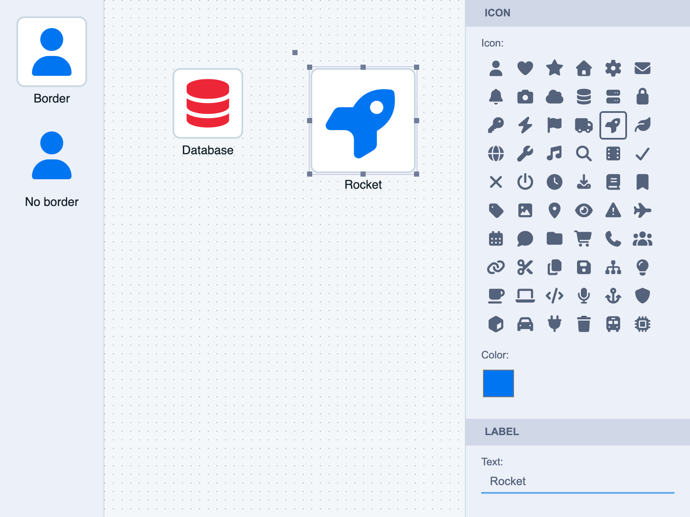

# JointJS+: Font Awesome Inspector (TypeScript) <a href="https://www.jointjs.com/jointjs-plus"></a>

A custom `FAIcon` element draws a Font Awesome glyph as SVG text. The icon is centered and scaled with `calc()` expressions (`fontSize: 'calc(0.7*s)'`), so it follows the element size when resized with `ui.FreeTransform`. The inspector edits the icon (a `select-button-group` of 60 icons), its color, and the label.

This demo is also available online at [demos.jointjs.com](https://demos.jointjs.com/font-awesome-inspector/).



## Project Structure

| File | Description |
|------|-------------|
| `src/app.ts` | Graph, paper and selection (free transform + inspector) |
| `src/FAIcon.ts` | The `FAIcon` element |
| `src/icons.ts` | The icons offered in the inspector |
| `src/inspector.ts` | The inspector configuration |
| `src/stencil.ts` | The stencil with a bordered and a borderless `FAIcon` |
| `src/styles.css` | Layout and the `FontAwesome` font face (from `@fortawesome/fontawesome-free`) |

## Running the Demo

To run this application you need to have access to the JointJS+ package. You can get it by having a JointJS+ license or by starting a [free trial](https://www.jointjs.com/free-trial).

If you are a trial user, you received your access token during the trial sign-up process.
If you are a customer, log in to the customer portal at https://my.jointjs.com to obtain your access token.

This example uses the `.npmrc` file to set up access to the JointJS+ private npm registry. By default it reads the authentication token from the `JOINTJS_NPM_TOKEN` environment variable, which you can set in your terminal or CI environment:

**macOS / Linux**:
```sh
export JOINTJS_NPM_TOKEN="jjs-xxxxxxxx-xxxx-xxxx-xxxx-xxxxxxxxxxxx"
```

**Windows (PowerShell)**:
```sh
$env:JOINTJS_NPM_TOKEN="jjs-xxxxxxxx-xxxx-xxxx-xxxx-xxxxxxxxxxxx"
```

Learn more about our [private npm registry here.](https://docs.jointjs.com/learn/help-center/npm-registry)

The icons come from [Font Awesome Free](https://fontawesome.com) (`@fortawesome/fontawesome-free`), installed from the public npm registry with no token. Its solid font is loaded in `src/styles.css`.

After setting up access to the JointJS+ package, install the dependencies and start the dev server:

```bash
npm install
npm run dev
```
