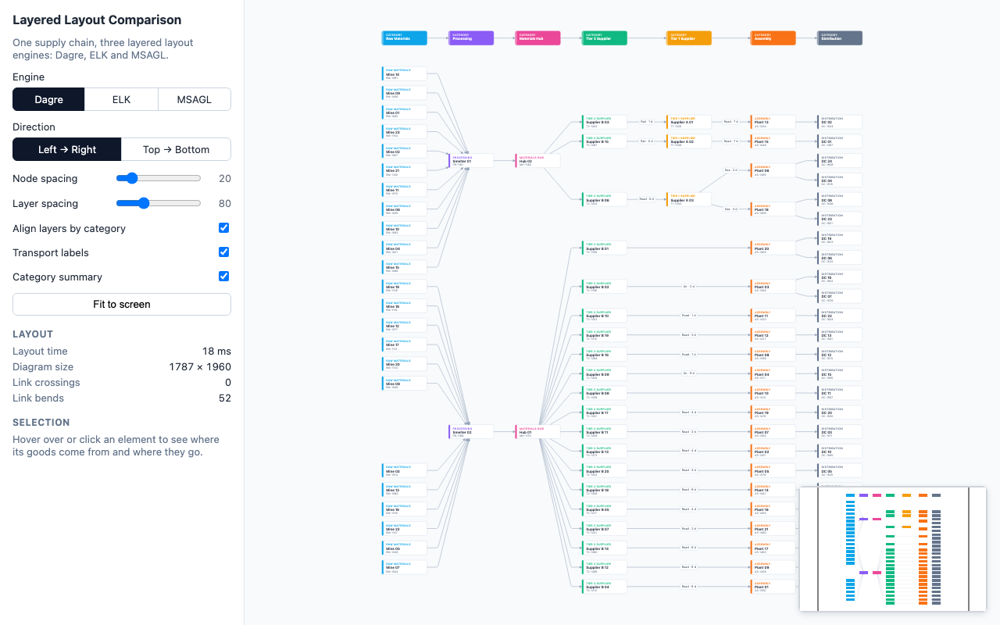

# JointJS+: Layered Layout Comparison 

A supply chain of 96 companies in seven stages, laid out by three layered layout engines: Dagre, ELK and MSAGL. Switch between them to compare how each one orders the companies, routes the links and places the labels. The layout can keep every company in the column of its stage, and hovering over or clicking a company traces its goods upstream and downstream.

This demo is also available online at [jointjs.com](https://jointjs.com/demos/layered-layout-comparison).

## Available Versions

- [TypeScript](./ts/)

## Screenshot

