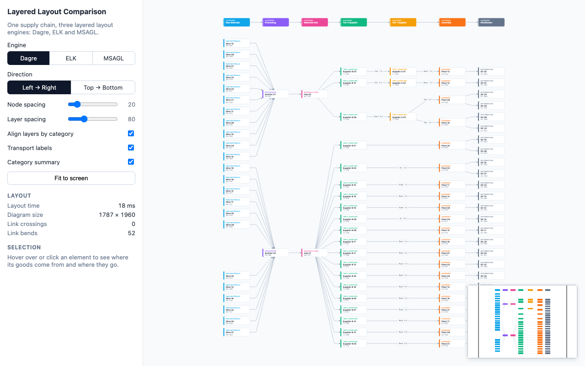

# JointJS+: Layered Layout Comparison (TypeScript) <a href="https://www.jointjs.com/jointjs-plus"></a>

A supply chain of 96 companies in seven stages, laid out by three layered layout engines: Dagre, ELK and MSAGL. Switch between them to compare how each one orders the companies, routes the links and places the labels. The layout can keep every company in the column of its stage, and hovering over or clicking a company traces its goods upstream and downstream.

This demo is also available online at [jointjs.com](https://jointjs.com/demos/layered-layout-comparison).



## Features

- **Three layout engines** -- Dagre (`@joint/layout-directed-graph`), ELK (`@joint/layout-elk`, running in a Web Worker) and MSAGL (`@joint/layout-msagl`). The sidebar shows the layout time, the size of the diagram and the number of link crossings and bends.
- **Layers by category** -- every company is placed in the layer of its stage, so links that skip a stage pass through the stages between. Dagre gets the layers from a custom ranker, ELK from layer partitions, and MSAGL from invisible helper elements added for the layout only.
- **Category summary** -- a lane with one node per stage, in line with the columns of the stages when the layers are aligned by category.
- **Focus** -- hovering over (after a short delay) or clicking a company highlights everything upstream and downstream of it and dims the rest.
- **Navigation** -- `ui.PaperScroller` scrolls and zooms the diagram; `ui.Navigator` shows a map of it, with the companies in the colors of their stages.

## Controls

| Action | Result |
|--------|--------|
| Hover over a company | Trace its goods upstream and downstream |
| Click a company / the blank paper | Keep the trace / clear it |
| Drag | Pan the diagram |
| Wheel / two-finger swipe | Scroll the diagram |
| Ctrl + wheel / pinch | Zoom in and out |
| Drag the frame in the navigator | Move to another part of the diagram |

## How to download this demo

You can download this demo using our [`@joint/cli` tool](https://www.npmjs.com/package/@joint/cli):

```bash
npx @joint/cli download layered-layout-comparison/ts
```

Alternatively, you can get the [copy of the repository](https://github.com/clientIO/joint-demos/archive/refs/heads/main.zip) from GitHub as usual.

## Running the application

To run this application you need to have access to JointJS+ package. You can get it by having a JointJS+ license or by starting a [free trial](https://www.jointjs.com/free-trial).

If you are a trial user, you received your access token during the trial sign-up process.
If you are a customer, log in to the customer portal at https://my.jointjs.com to obtain your access token.

This example uses `.npmrc` file to set up access to the JointJS+ private npm registry. By default it uses `JOINTJS_NPM_TOKEN` environment variable to get authentication token. You can set this environment variable in your terminal or CI environment in the following way:

**macOS / Linux**:
```sh
export JOINTJS_NPM_TOKEN="jjs-xxxxxxxx-xxxx-xxxx-xxxx-xxxxxxxxxxxx"
```

**Windows (PowerShell)**:
```sh
$env:JOINTJS_NPM_TOKEN="jjs-xxxxxxxx-xxxx-xxxx-xxxx-xxxxxxxxxxxx"
```

Learn more about our [private npm registry here.](https://docs.jointjs.com/learn/help-center/npm-registry)

After setting up access to JointJS+ package, install the dependencies by running:

```bash
npm install
```

And then start the application with:

```bash
npm run dev
```

To create a production build, run:

```bash
npm run build
```
