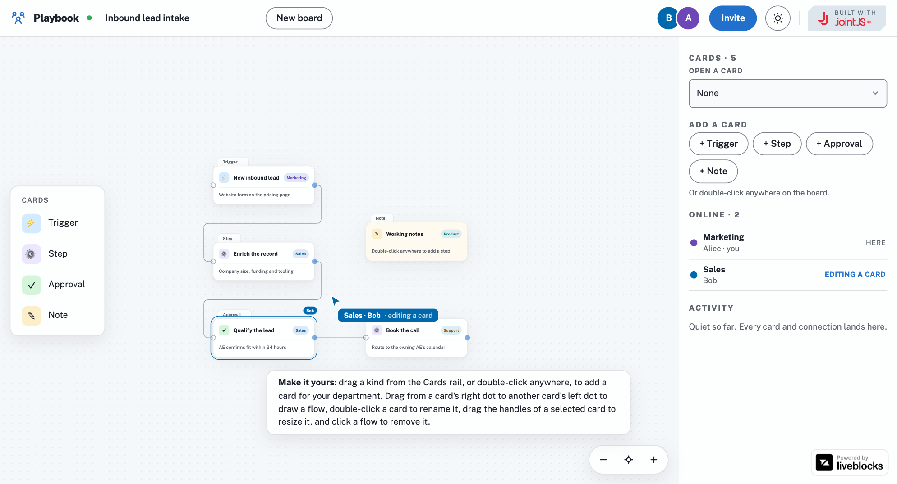

# JointJS+: Playbook, Real-Time Collaboration <a href="https://www.jointjs.com/jointjs-plus"></a>

Let your team design its processes together, on one live board. Playbook is a multiplayer process designer: everyone picks a department, maps triggers, steps, approvals and notes, and sees who is working where through live cursors, colored frames on the cards people are touching, and a shared activity feed. It is built with [`@joint/react-plus`](https://docs.jointjs.com/react) and [Liveblocks](https://liveblocks.io).

## Sync @joint/react with Liveblocks in a few lines

```tsx
import { Diagram, Paper, type IncrementalCellsChange } from '@joint/react-plus';
import { LiveblocksProvider, RoomProvider, ClientSideSuspense, useMutation, useStorage, useUpdateMyPresence } from '@liveblocks/react/suspense';
import { useMemo } from 'react';

// Storage cards -> controlled cells (the demo's full version adds ports, flows and styles: board/to-cells.ts).
const toCells = (cards: Record<string, Card>) =>
    Object.entries(cards).map(([id, c]) => ({ id, type: 'element', position: { x: c.x, y: c.y }, size: { width: c.width, height: c.height } }));

function Board() {
    // Read: the room's storage is the document; the diagram is drawn from it.
    const cards = useStorage((root) => root.cards);
    const cells = useMemo(() => toCells(cards), [cards]);
    // Write: what the user changed in the graph goes back to storage.
    const save = useMutation(({ storage }, { changed }: IncrementalCellsChange) => {
        for (const [id, cell] of changed) {
            if ('position' in cell && cell.position) storage.get('cards').get(String(id))?.update(cell.position);
        }
    }, []);
    // Presence: live, per-person state that is never stored.
    const updateMyPresence = useUpdateMyPresence();
    return (
        <Diagram cells={cells} onIncrementalCellsChange={save}>
            <div onPointerMove={(event) => updateMyPresence({ cursor: { x: event.clientX, y: event.clientY } })}>
                <Paper />
            </div>
        </Diagram>
    );
}

// The hooks need a room: wrap the board in the providers (storage types: src/liveblocks.config.ts).
<LiveblocksProvider publicApiKey="pk_..."><RoomProvider id="my-board" initialPresence={{ cursor: null }} initialStorage={{ cards: new LiveMap() }}>
    <ClientSideSuspense fallback="Loading..."><Board /></ClientSideSuspense>
</RoomProvider></LiveblocksProvider>
```

How it works: Liveblocks storage holds the playbook (a `LiveMap` of cards, each a `LiveObject`, so two people editing different fields of one card both win). `useStorage` hands React an immutable snapshot, and a small pure function (`toCells`) turns it into the controlled `cells` of `<Diagram>`. When someone drags or resizes a card, `onIncrementalCellsChange` reports just the changed cells, and a `useMutation` writes them to storage. Liveblocks then syncs the change to everyone, and every board, the author's included, re-draws from the same storage. Anything the graph holds that is not in storage (a dragged palette clone, a refused flow) disappears at the next sync, so the demo also keeps the local user's in-progress draft in the cells. Cursors and "who is editing what" travel as presence, which is live and never stored (the demo converts the cursor to graph coordinates, so it lands right at any zoom). The demo's real versions are in [`board/playbook-board.tsx`](./react/src/board/playbook-board.tsx), [`board/board-actions.ts`](./react/src/board/board-actions.ts) and [`board/to-cells.ts`](./react/src/board/to-cells.ts).

## Available Versions

- [React](./react/)

## Screenshot


