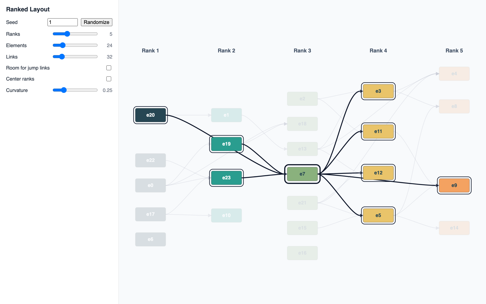

# JointJS: Ranked Layout

Elements are assigned to ranks given in advance. The layout keeps every element in the column of its rank and orders the elements within each rank so that linked elements line up and links cross as little as possible. Links may jump over ranks. A seeded generator creates random graphs of any size.

This demo is also available online at [demos.jointjs.com](https://demos.jointjs.com/ranked-layout/).

## Available Versions

- [TypeScript](./ts/)

## Screenshot

