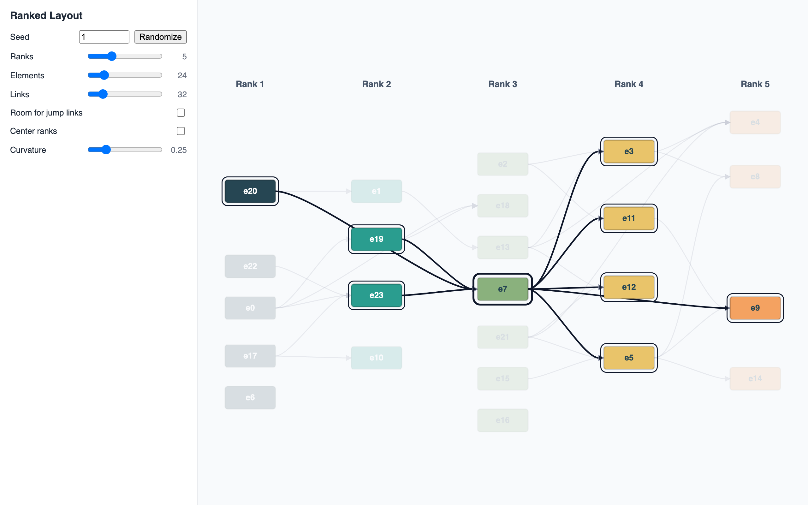

# JointJS: Ranked Layout (TypeScript)

Elements are assigned to ranks given in advance. The layout keeps every element in the column of its rank and orders the elements within each rank so that linked elements line up and links cross as little as possible. Links may jump over ranks. A seeded generator creates random graphs of any size.

This demo is also available online at [demos.jointjs.com](https://demos.jointjs.com/ranked-layout/).



<a href="https://stackblitz.com/github/clientio/joint-demos/tree/main/ranked-layout/ts" target="_blank">
  
</a>

## How It Works

1. Every element stores its `rank`. `layoutRanked()` (`src/layout.ts`) runs `DirectedGraph.layout()` (dagre) left to right with a custom `ranker` that sets each element's rank instead of letting dagre compute it. Dagre still orders the elements within each rank (fewer crossings) and positions them. The ranks are doubled because dagre doubles the length of every edge.
2. Links that jump over ranks are left out of the layout by default and drawn as a plain `curve` from source to target. With *Room for jump links* they take part in the layout: dagre keeps room for them in every rank they cross, and `setVertices` turns its route into vertices (simplified). Backward links (to an earlier rank) are always left out and drawn dashed, below the other links, as a curve from the left side of the source to the right side of the target. With *Fade backward links* they are nearly transparent; a badge (`BackwardLinksBadge`, a highlighter) on each source counts them and shows them on hover.
3. Dagre gives a rank without elements no width. An element-sized placeholder in every empty rank keeps the columns evenly spaced. The placeholders take part in the layout only; they never enter the graph.
4. `layoutRanked()` returns the center x of every column; the rank headers are placed above them.
5. *Center ranks* (`centerRanks()`) keeps the order dagre gave each rank but spaces its elements evenly around the middle of the diagram. The layout's vertices no longer fit and are removed.

## How to download this demo

You can download this demo using our [`@joint/cli` tool](https://www.npmjs.com/package/@joint/cli):

```bash
npx @joint/cli download ranked-layout/ts
```

Alternatively, you can get the [copy of the repository](https://github.com/clientIO/joint-demos/archive/refs/heads/main.zip) from GitHub as usual.

## Running the application

Install the dependencies by running:

```bash
npm install
```

And then start the application with:

```bash
npm run dev
```
